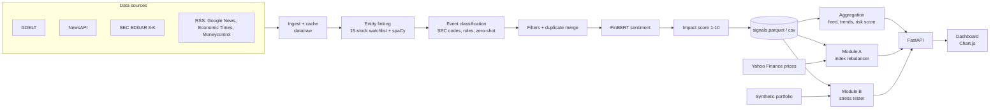

# MarketGuard AI: Real-time Risk Intelligence - S&P Global & Crisil Campus Hackathon

**Candidate Name:** Yashvi Raghuvanshi  
**College / Campus:** IIT Guwahati   
**Demo Video Link:** https://drive.google.com/drive/folders/1JnrT2iyWmfrG6JQXMQbod_wcL3S_lU34?usp=sharing   
**Slide Deck Link:** https://drive.google.com/drive/folders/1QLR8JI0JXpJWN_woMbPYULCRuSO3lpf9?usp=share_link     

---

## 1. Project Overview / Problem Statement & Approach

Financial risk often shows up first in unstructured text: a news headline, a regulatory filing, a market-moving tweet. This project is an **AI/NLP Risk Engine** that reads text from several live sources, finds the company or market segment it concerns, and converts it into structured signals: a **sentiment score** (-1 to +1), an **event type** (Geopolitical, Macroeconomic, Credit Event, Merger/Acquisition, Product Launch, Earnings, Regulatory/Legal) and an **impact score** (1-10). Signals are saved to file and served over an API.

On top of the engine I built **both** downstream modules from the problem statement:

- **Module A, Tactical Index Rebalancing.** A 15-stock mock index (S&P 100 names) is rebalanced hourly using company sentiment. Weight = start weight x (1 + sentiment), limited to 2-12% per stock and a 10% turnover cap per step. Compared with an equal-weight benchmark.
- **Module B, Strategic Portfolio Stress Testing.** Any event with impact 7+ triggers a stress test on a synthetic ~US$1.5bn wholesale-banking book (loans, bonds, derivatives, equities). The event type becomes a bundle of shocks to interest rates, oil, VIX and GDP growth, scaled by impact. Users can also run four preset scenarios or set shocks by hand.

One dashboard shows a **Live** mode (latest data) and a **Replay** mode (recorded signals along a timeline).

**Approach:** ingest and cache -> link to company and sector -> classify event -> remove junk and duplicates -> FinBERT sentiment -> impact score relative to recent news -> serve to both modules and the dashboard.

## 2. Architecture & Tech Stack



**How the engine works**

| Step | What it does | File |
|---|---|---|
| Ingest | Pulls four live sources and caches every fetch in `data/raw/`, so Replay works offline. A failed source falls back to its cached copy. | `src/ingest.py` |
| Entity linking | Matches 15 watchlist companies by name, cashtag (`$TSLA`) and exchange tag; spaCy NER resolves ambiguous names (Apple the company, not the fruit). Other news is market-wide, with a sector from sector words (oil -> Energy). | `src/entities.py` |
| Event type | SEC 8-K item numbers map directly to events; otherwise keyword rules; a small zero-shot model (DistilBERT-MNLI) only when rules are unsure. | `src/events.py` |
| Cleaning | Drops irrelevant results, fund-filing filler, coupons and off-topic stories. Merges the same story from several outlets (same company/event, similar words, within 6 hours). | `src/engine.py` |
| Sentiment | FinBERT: P(positive) - P(negative). VADER fallback if FinBERT cannot load. Cached. | `src/sentiment.py` |
| Impact | Event severity x sentiment strength x source trust, ranked against the last 72 hours so the top ~10% score 7+. Never uses future signals. | `src/events.py` |
| Aggregation | Feed, counts, event mix, sentiment trend, per-stock risk score (both directions, 24h half-life, half-strength sector spillover), stress banner. | `src/aggregate.py` |
| Module A | Hourly linear-tilt rebalancer; performance vs equal weight. | `src/rebalancer.py`, `src/prices.py` |
| Module B | Event/scenario -> shocks -> portfolio revaluation, loss by sector and type, 30-day path. | `src/portfolio.py`, `src/stress.py` |
| API + dashboard | FastAPI serves JSON and the dashboard; background refresh keeps Live mode current. | `src/api.py`, `web/index.html` |

**Tech stack**

- **Language and server:** Python, FastAPI, Uvicorn
- **Data:** pandas, NumPy, PyArrow (Parquet), feedparser, requests, yfinance. Plain CSV/Parquet files, no database.
- **AI/ML:** Hugging Face Transformers + PyTorch (`ProsusAI/finbert` sentiment, `typeform/distilbert-base-uncased-mnli` zero-shot events), spaCy (`en_core_web_sm`), VADER
- **Frontend:** single HTML file with Chart.js (CDN), no framework

**Key design choices**

- *Relative impact scale.* Fixed scales go quiet on slow news days, so "7" means "high compared with the last 72 hours".
- *Rules first, model second.* Rules and SEC codes are fast and explainable; the zero-shot model only sees texts the rules cannot place.
- *No look-ahead.* Every function takes an `as_of` time and ignores later signals, so Replay is honest.
- *Offline-safe.* All fetched data is cached; only chart and font files need the internet.

## 3. Dataset Used

All data is public or synthetic. No confidential or client data is used.

| Data | Source | Use |
|---|---|---|
| News headlines | **GDELT** DOC API  | Global topic searches: geopolitical, macro, credit, M&A, regulatory |
| News headlines | **NewsAPI**| Company headlines and US business top headlines |
| Financial news with labels | **Kaggle "Sentiment Analysis for Financial News"**  | Sentiment validation (small sample in `data/raw/financial_news.csv`) |
| Tweets | **Kaggle "Stock Tweets for Sentiment Analysis and Prediction"** | Loader and sample (`data/raw/stock_tweets.csv`) |
| Company filings | **SEC EDGAR 8-K** | Item numbers give exact event types |
| News feeds | **RSS**: Google News, Economic Times, Moneycontrol | Company and Indian-market headlines |
| Market prices | **Yahoo Finance** via `yfinance`| Daily closes for Module A performance |
| Portfolio | **Synthetic**, from `src/portfolio.py` | Module B book of ~100 positions |


## 4. Quickstart & Installation

Runtime: Python [3.x, run `python --version`] on [macOS, confirm]

The repo includes recorded data in `data/`, so the dashboard runs **without any API keys**.

```bash
git clone <your-repo-url>
cd <repo-folder>
python -m venv .venv
source .venv/bin/activate              # Windows PowerShell: .venv\Scripts\Activate.ps1
python -m pip install -r requirements.txt
python -m spacy download en_core_web_sm
cp .env.example .env                   # works as is; add keys only for Live fetching
python -m src.api
```

Open **http://localhost:8000**. The dashboard starts in Replay mode at the end of the recorded window: press play, drag the timeline, or switch to Live. API docs: http://localhost:8000/docs.

**Entry point:** `python -m src.api`

**Optional commands**

```bash
python -m src.engine live              # fetch fresh data and rebuild signals (needs NEWSAPI_KEY and SEC_USER_AGENT in .env)
python -m src.prices                   # refresh daily prices
python -m src.validate_sentiment 300   # sentiment accuracy on Kaggle sample, writes docs/sentiment_validation.md
```

**Settings (`.env`)**

| Variable | Purpose |
|---|---|
| `NEWSAPI_KEY` | Free key from newsapi.org. Without it NewsAPI is skipped; other sources still work. |
| `SEC_USER_AGENT` | Your name and email (required by the SEC for EDGAR). |
| `AUTO_REFRESH` | `0` (default) disables background live refresh; `1` refreshes every `REFRESH_MINUTES` minutes. |

**Dashboard tabs**

1. **Risk Engine:** signal counts, event mix, sentiment trend, top assets by risk score. A live signal feed stays visible on every tab.
2. **Index Rebalancing (Module A):** weights over time, current vs starting weights, performance vs equal-weight benchmark.
3. **Stress Testing (Module B):** trigger banner, before/after portfolio value, loss by sector, shock sliders, four preset scenarios.

## 5. Key Results & Domain Impact

**What the prototype demonstrates**

- An end-to-end pipeline from four live text sources to structured, time-stamped signals, with Live and no-look-ahead Replay modes.
- Example run: **[695] signals** from **[4] sources** over **[Oct 10-17]**, with about **[10%]** rated high-impact (7+). *(Update after your final run.)*
- **Sentiment accuracy** on 300 labelled financial sentences from the Kaggle set (details in [`docs/sentiment_validation.md`](docs/sentiment_validation.md)):

| Model | Accuracy | Macro-F1 |
|---|---|---|
| **FinBERT** (used) | **85.7%** | **0.86** |
| VADER (naive baseline) | 59.3% | 0.49 |

  The neutral band (+/-0.30) was tuned on this same sample, so the figure is slightly optimistic.
- **Module A:** the index tilts toward companies with positive news and away from negative, within hard limits, measured against equal weight.
- **Module B:** an impact 7+ event produces an impact-scaled shock, before/after portfolio value, loss by sector and asset type, and the driving factor (rates, oil, VIX, GDP, sector).


## 6. Repository Structure

```
<repo>/
├── README.md
├── LICENSE
├── requirements.txt
├── .env.example
├── src/                     # engine, modules and API
│   ├── config.py            # all settings
│   ├── ingest.py  entities.py  events.py  sentiment.py  engine.py
│   ├── aggregate.py  rebalancer.py  prices.py  portfolio.py  stress.py
│   ├── validate_sentiment.py
│   └── api.py
├── web/index.html           # dashboard
├── scripts/                 # make_kaggle_samples.py, check_setup.py
├── data/
│   ├── raw/                 # Kaggle samples + recorded source files
│   └── processed/           # signals, prices, portfolio
└── docs/                    # presentation.pdf, architecture.png, sentiment_validation.md, screenshots/
```

## 7. License

MIT, see [`LICENSE`](LICENSE).
